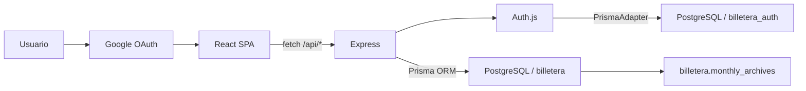

# Arquitectura técnica — Tu Billetera

## 1. Estado

Este documento describe la implementación vigente al 5 de noviembre de 2026. La
aplicación es una SPA React atendida por Express y usa PostgreSQL como fuente de
verdad mediante Prisma ORM. Localmente trabaja con la base `tu_billetera`; en
Vercel usa el recurso existente Prisma Postgres `prisma-postgres-indigo-tree`.
Los datos financieros viven en `billetera` y las cuentas OAuth y sesiones en
`billetera_auth`. El cliente y la API no dependen de Supabase, Firebase ni Neon.

## 2. Tecnologías

| Área | Tecnología | Uso |
| --- | --- | --- |
| Runtime | Node.js 26.5.0 | Servidor, scripts y compilación |
| Gestor | npm 11.17.0 | Dependencias y comandos |
| Lenguaje | TypeScript 5.8 | Cliente, API y migraciones |
| UI | React 19 | Componentes y estado |
| Empaquetado | Vite 6 | Cliente de desarrollo y producción |
| Estilos | Tailwind CSS 4 | Diseño adaptable |
| API | Express 4 | Rutas privadas y archivos estáticos |
| Base de datos local | PostgreSQL 18.4 | Presupuesto, gastos e informes |
| Base de producción | Prisma Postgres | PostgreSQL administrado existente |
| ORM | Prisma ORM 7.9 | Cliente tipado, modelos y transacciones |
| Adaptador | `@prisma/adapter-pg` | Conexión Prisma sobre el controlador `pg` |
| Autenticación | Auth.js + Google OAuth | Acceso permitido por correo |
| Hosting | Vercel | SPA, función Express y protección de acceso |
| Gráficos | Recharts 3 | Gasto diario |
| Animación | Motion 12 | Transiciones |

## 3. Flujo



- React nunca recibe credenciales de base de datos.
- Express es la única capa que abre conexiones PostgreSQL.
- Auth.js valida Google y crea sesiones persistentes de 30 días.
- En Vercel solo se aceptan correos incluidos en `AUTH_ALLOWED_EMAILS`.
- Los datos financieros permanecen en memoria de React y no se guardan en
  `localStorage`, para impedir fugas visuales al cambiar de cuenta.
- Cada consulta y escritura recibe el `user.id` validado por Auth.js.
- Las escrituras se reflejan después de la confirmación de la API.
- La conexión usa un pool limitado y tiempos máximos de espera.

## 4. Estructura relevante

```text
.
├── database/
│   ├── migrate.ts
│   └── migrations/
│       ├── 001_initial_wallet.sql
│       ├── 002_isolate_billetera_schema.sql
│       ├── 003_prisma_auth.sql
│       ├── 004_wallet_display_name.sql
│       └── 005_private_wallets_by_user.sql
├── prisma/
│   └── schema.prisma
├── prisma.config.ts
├── api/
│   └── index.ts
├── docs/
├── scripts/
│   ├── claim-legacy-wallet-owner.ts
│   ├── import-expenses-only.ts
│   ├── test-wallet-isolation.ts
│   └── macos/
│       └── com.jordan.tu-billetera.plist
├── src/
│   ├── components/
│   │   ├── AuthGate.tsx
│   │   └── UserMenu.tsx
│   ├── server/
│   │   ├── app.ts
│   │   ├── auth.ts
│   │   ├── postgres.ts
│   │   ├── prisma.ts
│   │   ├── validation.ts
│   │   └── walletRepository.ts
│   ├── App.tsx
│   ├── monthlyReportDocument.ts
│   └── types.ts
├── .env.example
├── package.json
├── server.ts
└── vercel.json
```

Responsabilidades:

- `database/migrate.ts`: aplica archivos SQL pendientes y registra su nombre.
- `database/migrations/`: esquema reproducible de PostgreSQL.
- `prisma/schema.prisma`: modelos de los esquemas `billetera` y
  `billetera_auth`.
- `src/server/postgres.ts`: entorno y configuración de conexión.
- `src/server/prisma.ts`: cliente Prisma único con `PrismaPg`.
- `src/server/walletRepository.ts`: consultas Prisma, transacciones y cierre
  mensual.
- `src/server/auth.ts`: Google OAuth, sesiones y lista de correos permitidos.
- `src/server/app.ts`: contratos HTTP y manejo de errores.
- `src/server/validation.ts`: validación de entrada y respaldos.
- `src/monthlyReportDocument.ts`: genera el documento HTML descargable.
- `src/App.tsx`: navegación, estado en memoria y llamadas a la API.
- `scripts/import-expenses-only.ts`: inserta solo gastos faltantes de una copia
  validada en el propietario indicado por `BILLETERA_OWNER_EMAIL`; no reemplaza
  presupuesto, mes, informes, papelera ni sesiones.
- `scripts/claim-legacy-wallet-owner.ts`: asigna una billetera anterior a la
  cuenta Auth.js indicada, después de una simulación y sin mezclar dos
  billeteras existentes.
- `scripts/test-wallet-isolation.ts`: comprueba separación de nombres,
  presupuestos, gastos e identificadores entre dos propietarios.
- `scripts/macos/com.jordan.tu-billetera.plist`: servicio de usuario que mantiene
  la aplicación local activa en macOS.

## 5. Configuración local

La base creada en este computador es `tu_billetera` sobre PostgreSQL 18.4. El
archivo `.env.local` usa:

```dotenv
DATABASE_URL="postgresql://127.0.0.1:5432/tu_billetera"
HOST="127.0.0.1"
PORT="3002"
AUTH_SECRET="una-clave-aleatoria-larga"
AUTH_GOOGLE_ID="cliente-oauth-de-google"
AUTH_GOOGLE_SECRET="secreto-oauth-de-google"
AUTH_ALLOWED_EMAILS="correo1@gmail.com,correo2@gmail.com"
BILLETERA_LEGACY_OWNER_EMAIL="cuenta-principal@gmail.com"
AUTH_LOCAL_BYPASS="false"
```

El puerto 3002 es exclusivo de Billetera en este Mac: GRANJITA usa 3000 y
COMPRAS usa 3001. El host por defecto `127.0.0.1` impide que la API local quede
expuesta a otros equipos de la red. Si `DATABASE_URL` no existe, el servidor
admite `PGHOST`, `PGPORT`, `PGDATABASE`, `PGUSER` y `PGPASSWORD`, con valores
locales seguros por defecto.

Las credenciales nunca deben usar prefijo `VITE_` ni enviarse al navegador. El
atajo `AUTH_LOCAL_BYPASS=true` solo se acepta fuera de Vercel y para hosts
loopback; sirve para desarrollo local sin debilitar producción.

## 6. Modelo de datos

Todas las tablas y funciones de la aplicación viven en el esquema PostgreSQL
`billetera`. La migración `002_isolate_billetera_schema.sql` mueve una instalación
local antigua desde `public` sin borrar datos. En Prisma Postgres, `public`
conserva las tablas de la aplicación Supervisar y no es consultado por Billetera.

### `wallet_settings`

Una fila por usuario autenticado:

| Columna | Tipo | Regla |
| --- | --- | --- |
| `id` | `text` | PK interna de la configuración |
| `owner_id` | `text` | Identificador Auth.js único del propietario |
| `display_name` | `text` | Nombre personal; entre 1 y 60 caracteres |
| `monthly_budget` | `bigint` | Entero no negativo |
| `active_month` | `date` | Primer día del mes activo |
| `updated_at` | `timestamptz` | Última actualización |

### `expenses`

| Columna | Tipo | Regla |
| --- | --- | --- |
| `id` | `text` | Identificador generado por Express |
| `owner_id` | `text` | Propietario Auth.js |
| `amount` | `bigint` | Entero positivo |
| `category` | `text` | Una de las seis categorías |
| `spent_on` | `date` | Fecha del mes activo |
| `description` | `text` | Entre 1 y 500 caracteres |
| `deleted_at` | `timestamptz` | `null` si está activo |
| `created_at` | `timestamptz` | Creación |
| `updated_at` | `timestamptz` | Último cambio |

La PK es compuesta por `owner_id` e `id`, por lo que dos usuarios pueden
restaurar copias con los mismos identificadores sin colisionar. Hay índices
parciales por propietario para activos por fecha y para la papelera.

### `monthly_archives`

| Columna | Tipo | Contenido |
| --- | --- | --- |
| `month_start` | `date` | Primer día del mes |
| `owner_id` | `text` | Propietario Auth.js |
| `monthly_budget` | `bigint` | Presupuesto del periodo |
| `total_spent` | `bigint` | Total de gastos activos |
| `expense_count` | `bigint` | Cantidad de activos |
| `deleted_expense_count` | `bigint` | Cantidad en papelera |
| `expenses` | `jsonb` | Detalle para el informe |
| `deleted_expenses` | `jsonb` | Detalle de papelera |
| `archived_at` | `timestamptz` | Fecha del cierre |

La PK de los informes es compuesta por `owner_id` y `month_start`.

### `schema_migrations`

Registra cada SQL aplicado para que `npm run db:migrate` sea repetible.

### Esquema `billetera_auth`

La migración `003_prisma_auth.sql` crea las tablas `users`, `accounts`,
`sessions` y `verification_tokens` esperadas por el adaptador oficial de Auth.js.
Las relaciones de cuentas y sesiones eliminan en cascada al borrar el usuario.
No almacenar estas tablas en `public` ni mezclarlas con los gastos.

## 7. Cierre mensual

`billetera.rollover_wallet_month_for_owner(owner_id, target_month)` ejecuta todo
el cambio de una sola billetera dentro de la misma transacción PostgreSQL:

1. Valida que el destino sea el primer día del mes actual de Colombia.
2. Toma un bloqueo asesor transaccional específico del usuario para evitar
   cierres simultáneos.
3. Bloquea la fila de configuración.
4. Agrega gastos y papelera por cada mes pendiente.
5. Inserta o actualiza la instantánea de `monthly_archives`.
6. Elimina únicamente las filas pertenecientes al mes ya archivado.
7. Avanza `active_month`.

La API llama esta función al cargar los datos del usuario y antes de las
escrituras relevantes. Este cierre perezoso funciona aunque el computador haya
estado apagado el día primero: ocurre en la primera solicitud posterior y puede
recuperar varios meses pendientes. No requiere `pg_cron` ni un proceso externo.

## 8. API

| Método y ruta | Resultado |
| --- | --- |
| `GET /api/health` | Conexión, ORM y estado de configuración de Google |
| `GET /api/session` | Sesión actual o `null` |
| `/api/auth/*` | Inicio, callback y cierre de sesión de Auth.js |
| `GET /api/data` | Estado del mes e informes disponibles |
| `GET /api/reports/:month` | Informe completo `YYYY-MM` |
| `POST /api/settings/name` | Valida y actualiza el nombre personal |
| `POST /api/budget` | Actualiza el presupuesto |
| `POST /api/expenses` | Crea un gasto del mes activo |
| `DELETE /api/expenses/:id` | Envía a papelera |
| `POST /api/expenses/:id/restore` | Restaura |
| `DELETE /api/expenses/:id/permanent` | Elimina definitivamente |
| `POST /api/expenses/trash/empty` | Vacía la papelera |
| `POST /api/import` | Reemplazo transaccional desde JSON |

El JSON está limitado a 1 MB. `health`, `session` y `auth` son rutas públicas;
todas las rutas financieras requieren una sesión y responden `401` en caso
contrario. El middleware convierte la sesión en un propietario y el repositorio
incluye ese `owner_id` en cada lectura, creación, actualización, borrado,
restauración, importación e informe. Prisma parametriza las consultas de
modelos; solo el cierre mensual usa SQL tipado mediante `$queryRaw`.

El callback de sesión de Auth.js agrega explícitamente el identificador interno
del usuario a `session.user.id`. El nombre, correo o fotografía de Google no se
usan como clave de propiedad y no sustituyen ese identificador.

El nombre del encabezado se normaliza en la API, se guarda en la fila del
usuario y vuelve dentro de su `WalletSnapshot`. La confirmación de PostgreSQL
determina cuándo la edición se considera guardada.

## 9. Informes descargables

`GET /api/reports/:month` recupera la instantánea cerrada. El cliente la entrega
a `downloadMonthlyReportDocument`, que escapa todo texto antes de construir un
HTML autónomo y lo descarga mediante `Blob` y una URL temporal. El archivo puede
imprimirse o guardarse como PDF sin conexión a la aplicación.

## 10. Ejecución

```bash
brew services start postgresql@18
createdb -h 127.0.0.1 tu_billetera   # solo la primera vez
npm install
npm run db:migrate
npm run dev
```

Abrir `http://127.0.0.1:3002`.

Verificación:

```bash
npm run check
curl http://127.0.0.1:3002/api/health
curl http://127.0.0.1:3002/api/data
```

`npm start` sirve el contenido compilado de `dist/` y permanece conectado al
mismo PostgreSQL.

### Servicio local permanente en macOS

El LaunchAgent `com.jordan.tu-billetera` ejecuta `dist/server.js` con Node,
`NODE_ENV=production`, `HOST=127.0.0.1` y `PORT=3002`. Su definición versionada
es `scripts/macos/com.jordan.tu-billetera.plist` y la copia activa está en
`~/Library/LaunchAgents/com.jordan.tu-billetera.plist`.

Tiene `RunAtLoad` y `KeepAlive`, por lo que arranca al iniciar sesión y se
recupera si el proceso termina. Tras cambiar el código se debe ejecutar
`npm run check`, aplicar migraciones y reiniciar solo ese servicio:

```bash
launchctl kickstart -k gui/$(id -u)/com.jordan.tu-billetera
```

Comprobaciones:

```bash
launchctl print gui/$(id -u)/com.jordan.tu-billetera
lsof -nP -iTCP:3002 -sTCP:LISTEN
```

## 11. Estado verificado

- PostgreSQL 18.4 activo mediante Homebrew.
- Base independiente `tu_billetera` creada.
- Migraciones `001_initial_wallet.sql`, `002_isolate_billetera_schema.sql`,
  `003_prisma_auth.sql`, `004_wallet_display_name.sql` y
  `005_private_wallets_by_user.sql` aplicadas localmente y en Production.
- `npm run test:isolation` confirmó nombres, presupuestos y gastos separados,
  identificadores de gasto repetibles entre propietarios y bloqueo de una
  modificación cruzada.
- La billetera histórica de Production fue asignada a la cuenta principal sin
  cambiar su contenido: 6 gastos vigentes y 3 informes conservaron sus datos y
  solo recibieron el propietario Auth.js correspondiente.
- El mes y los importes son estado dinámico. El 2 de noviembre de 2026 la
  sesión autorizada confirmó el periodo `2026-11-01`; para valores vigentes se
  debe consultar la API o PostgreSQL.
- Respaldo local `respaldo_mis_gastos_2026-08-01.json` restaurado sin consultar
  servicios externos.
- Informe de julio: 28 gastos, 2 eliminados y 776.100 COP gastados.
- Al restaurar el respaldo, agosto tenía 1 gasto por 2.000 COP. El 12 de agosto,
  el estado local activo contiene 12 gastos por 649.200 COP y papelera vacía.
- El 12 de agosto, Production recibió únicamente los 12 gastos activos del
  respaldo de esa fecha, por 649.200 COP. El presupuesto siguió en 1.500.000
  COP, el disponible quedó en 850.800 COP y se conservaron mes, informes,
  papelera y sesiones.
- Una segunda simulación del importador omitió los 12 identificadores ya
  presentes y confirmó que la operación es idempotente.
- `GET /api/health`: `database = postgresql`, `orm = prisma`.
- `GET /api/data` y `GET /api/reports/2026-07`: correctos.
- TypeScript y compilación de producción: correctos.
- LaunchAgent `com.jordan.tu-billetera` activo, con `RunAtLoad`, `KeepAlive` y
  escucha exclusiva en `127.0.0.1:3002`.
- El error de Safari “no puede conectarse al servidor” reapareció el 2 de agosto
  porque el proceso iniciado manualmente no sobrevivió. Se resolvió de forma
  permanente con el LaunchAgent; el Dashboard se verificó visualmente en Safari.
- Separación comprobada por `cwd`: GRANJITA escucha en 3000 desde su propia
  carpeta y Billetera en 3002 desde `tu-billetera`.

El respaldo correcto fue exportado el 1 de agosto de 2026 y contiene movimientos
entre el 14 de julio y el 1 de agosto. Su SHA-256 es
`a91026a54c2e9863f9c7da0178786b14f94cda619293145661147ecdc4a9be4d`.

La copia usada para transferir solo gastos a Production fue exportada el 12 de
agosto de 2026. Su SHA-256 es
`2617622df0cfcf9f0f83df4852fe11ac9624310db5095b7abab2b93d3bd1e353`;
contiene 12 gastos activos por 649.200 COP y ninguna fila en la papelera.

## 12. Despliegue y seguridad

- Proyecto exclusivo: `mctesman/tu-billetera-angie-jordan`.
- Despliegue final verificado el 5 de noviembre de 2026:
  `dpl_3vNkfXyqumCvtaU5f9tmTzA6Kavt`, estado `READY`.
- Host protegido de esa versión:
  `https://tu-billetera-angie-jordan-o6piawdyv-mctesman.vercel.app`.
- Alias público transferido definitivamente el 2 de noviembre de 2026:
  `https://billetera-pearl.vercel.app`. Su propiedad pasó del proyecto antiguo
  `billetera` a `tu-billetera-angie-jordan` y el despliegue correcto fue
  promovido después de la transferencia.
- En el alias público, la raíz y `/api/health` responden `200`,
  `/api/session` responde `null` y `/api/data` responde `401` sin sesión.
  `health` confirma `database=postgresql`, `orm=prisma` y
  `auth.configured=true`. También devuelve `auth.allowedEmailCount=2` sin
  exponer las direcciones.
- En una sesión autorizada, el Dashboard recuperó el nombre personal y los
  importes históricos después de recargar el alias público. La sesión incluyó
  el `user.id` de Auth.js, no apareció ninguna alerta de conexión y Vercel no
  registró errores del despliegue dentro de la ventana consultada.
- Recurso de datos existente: `prisma-postgres-indigo-tree`.
- La integración entrega `DATABASE_URL`, `PRISMA_DATABASE_URL` y `POSTGRES_URL`
  solo al entorno Production del proyecto de Billetera.
- El pool limita producción a dos conexiones por función.
- `vercel-build` ejecuta `prisma generate` y `vite build`; Vercel compila
  `api/index.ts` como función independiente y `vercel.json` reescribe
  `/api/:path*` hacia ella.
- El generador Prisma usa ESM e `importFileExtension = "js"`; sin este ajuste la
  función transpila los archivos pero intenta importar extensiones `.ts`, lo que
  provoca `FUNCTION_INVOCATION_FAILED`.
- `getPoolConfig` convierte los modos SSL heredados `prefer`, `require` y
  `verify-ca` en `verify-full`, conservando la validación fuerte y evitando que
  el controlador `pg` registre su advertencia de compatibilidad como error.
- El bloqueo asesor de las importaciones se consulta desde una subconsulta que
  devuelve un entero. Esto conserva la exclusión transaccional sin pedirle a
  Prisma que deserialice el tipo PostgreSQL `void`.

La base física de Prisma Postgres también sirve a Supervisar, pero el esquema
`billetera` evita mezclar tablas o consultas. COMPRAS no está enlazado al proyecto
ni al host de Billetera. No usar Neon, Supabase o Firebase para este proyecto.

Vercel Authentication protege las URLs únicas de despliegue y Auth.js protege el
alias público. El proyecto Google Cloud independiente es `Tu Billetera`
(`static-welder-505317-g2`), con público externo en modo Prueba. El cliente web
autoriza el origen `https://billetera-pearl.vercel.app` y su callback exacto.
`AUTH_SECRET`, `AUTH_GOOGLE_ID`, `AUTH_GOOGLE_SECRET`, `AUTH_ALLOWED_EMAILS` y
`BILLETERA_LEGACY_OWNER_EMAIL` están guardadas como variables sensibles solo de
Production; sus valores no se documentan ni se exponen al cliente. La última
variable solo permite reclamar de forma segura una instalación antigua que aún
use el propietario reservado `legacy-shared-wallet`.

Las cuentas permitidas actuales son `mctesmanrh@gmail.com` y
`giozulsanty2013@gmail.com`. Para habilitar otra cuenta, agregarla tanto a los
usuarios de prueba de Google como a `AUTH_ALLOWED_EMAILS` y desplegar de nuevo.
El callback registra únicamente la razón de un rechazo —proveedor, correo
ausente, verificación o lista— y nunca imprime la dirección recibida.

El 2 de noviembre de 2026 el dominio todavía pertenecía al proyecto antiguo y
era servido por una versión previa. Esto causó rechazos de la lista de correos y
coincidió con tiempos de espera del adaptador de Prisma Postgres. La
reparación transfirió el alias, promovió el despliegue nuevo y volvió a comprobar
que `/api/health` responde `200`, `/api/session` responde `null`, `/api/data`
anónimo responde `401`, el inicio OAuth redirige a Google y no quedan errores
recientes en los registros.

Desplegar versiones candidatas con `--skip-domain`, comprobar `health`, el `401`
anónimo y un inicio de sesión real antes de mover el alias público estable
`https://billetera-pearl.vercel.app`. No moverlo al proyecto viejo. El callback
OAuth debe seguir siendo exactamente
`https://billetera-pearl.vercel.app/api/auth/callback/google`.

Los secretos descargados viven en `.env.vercel.production.local` y
`.vercel/.env.production.local`, ambos ignorados por Git. No imprimirlos ni
copiarlos a variables `VITE_*`. Para migrar el esquema remoto puede usarse
`BILLETERA_ENV_FILE=.env.vercel.production.local npm run db:migrate`.

La carga autorizada del 12 de agosto de 2026 fue selectiva:
`scripts/import-expenses-only.ts` validó la copia, insertó solo los gastos
faltantes y preservó presupuesto, mes activo, informes, papelera y sesiones.
Es un antecedente histórico, no una descripción del saldo vigente. El modo
normal es simulación; `--apply` habilita la escritura y `--production` exige que
Vercel confirme `VERCEL_ENV=production`.

Los borrados definitivos y la importación completa son operaciones destructivas,
por lo que la interfaz mantiene confirmaciones y copias JSON recuperables.
