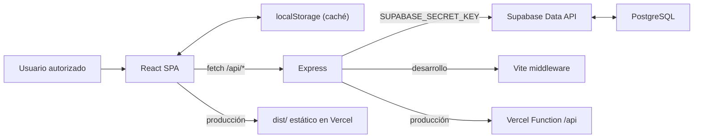

# Arquitectura técnica — Tu Billetera

## 1. Estado y alcance

Este documento describe la implementación vigente al 29 de julio de 2026.
La aplicación es una SPA React atendida por Express y utiliza Supabase
PostgreSQL como fuente principal de datos.

La persistencia anterior mediante `data/db.json` fue retirada. Tampoco existen
dependencias, configuración ni código Firebase en el proyecto.

## 2. Tecnologías

| Área | Tecnología | Uso |
| --- | --- | --- |
| Runtime local | Node.js 26.5.0 | Servidor, herramientas y compilación |
| Gestor | npm 11.17.0 | Dependencias y scripts |
| Lenguaje | TypeScript 5.8 | Cliente y servidor |
| UI | React 19 | Componentes y estado |
| Empaquetado | Vite 6 | Desarrollo y compilación del cliente |
| Estilos | Tailwind CSS 4 | Clases utilitarias y tema |
| API | Express 4 | API privada de la aplicación y archivos estáticos |
| Base de datos | Supabase PostgreSQL 17 | Presupuesto, gastos y papelera |
| Cliente DB | `@supabase/supabase-js` 2.111.0 | Acceso exclusivo desde Express |
| Gráficos | Recharts 3 | Barras de gasto diario |
| Animación | Motion 12 | Transiciones entre vistas |
| Íconos | Lucide React | Iconografía |
| Empaquetado servidor | esbuild | Genera `dist/server.cjs` |

`@supabase/supabase-js` está fijado a una versión exacta. La dependencia
`@google/genai` fue eliminada y las antiguas variables de Gemini ya no existen.

## 3. Arquitectura



Decisiones principales:

- React nunca recibe ni importa la clave secreta.
- Express es la única capa que crea el cliente Supabase.
- PostgreSQL es la fuente de verdad.
- `localStorage` conserva la última instantánea válida como caché de lectura.
- Las escrituras se reflejan en la UI después de recibir confirmación del servidor.
- No se envía una importación completa al cerrar u ocultar la pestaña.

## 4. Proyecto Supabase

| Campo | Valor |
| --- | --- |
| Project ref | `ykjemmwzkhgjvxgjkmoh` |
| Región | `us-east-1` |
| Estado verificado | `ACTIVE_HEALTHY` |
| PostgreSQL | 17 |

Migraciones aplicadas y guardadas localmente:

- `20260729220505_create_billetera_schema.sql`
- `20260729220735_add_replace_wallet_snapshot_function.sql`
- `20260729231215_fix_replace_wallet_snapshot_delete.sql`

Los tipos generados por Supabase están en `src/database.types.ts`.

## 5. Estructura relevante

```text
.
├── api/
│   └── index.ts
├── docs/
│   ├── DESCRIPCION_PAGINA.md
│   └── ARQUITECTURA_TECNICA.md
├── src/
│   ├── components/
│   ├── server/
│   │   ├── app.ts
│   │   ├── supabase.ts
│   │   ├── validation.ts
│   │   └── walletRepository.ts
│   ├── App.tsx
│   ├── database.types.ts
│   ├── data.ts
│   ├── main.tsx
│   └── types.ts
├── supabase/
│   └── migrations/
├── .env.example
├── .env.local
├── index.html
├── package.json
├── server.ts
└── vercel.json
```

Responsabilidades:

- `src/App.tsx`: estado de UI, caché local, navegación y llamadas HTTP.
- `src/server/app.ts`: aplicación Express compartida por el servidor local y
  la Function de Vercel.
- `src/server/supabase.ts`: carga segura de entorno y cliente Supabase.
- `src/server/validation.ts`: validación de presupuesto, gastos y respaldos.
- `src/server/walletRepository.ts`: consultas y mutaciones de base de datos.
- `server.ts`: arranque local, Vite en desarrollo y archivos estáticos en la
  ejecución Node tradicional.
- `api/index.ts`: entrada serverless de Express para Vercel.
- `vercel.json`: dirige las solicitudes `/api/*` a la Function.
- `supabase/migrations/`: definición reproducible del esquema remoto.

## 6. Modelo de datos

### `wallet_settings`

Tabla singleton para el presupuesto compartido:

| Columna | Tipo | Regla |
| --- | --- | --- |
| `id` | `text` | PK y siempre `main` |
| `monthly_budget` | `bigint` | Mayor o igual a cero |
| `updated_at` | `timestamptz` | Última actualización |

La migración inserta `main` con un presupuesto inicial de 1.500.000 COP.

### `expenses`

| Columna | Tipo | Regla |
| --- | --- | --- |
| `id` | `text` | PK generada por Express |
| `amount` | `bigint` | Entero mayor a cero |
| `category` | `text` | Una de las seis categorías permitidas |
| `spent_on` | `date` | Fecha `YYYY-MM-DD` |
| `description` | `text` | Entre 1 y 500 caracteres |
| `deleted_at` | `timestamptz` | `null` para activo; fecha para papelera |
| `created_at` | `timestamptz` | Creación |
| `updated_at` | `timestamptz` | Última modificación |

Índices parciales:

- Activos por `spent_on desc, created_at desc`.
- Papelera por `deleted_at desc`.

## 7. Seguridad de Supabase

Las dos tablas:

- Tienen RLS activado.
- No tienen políticas públicas.
- Revocan todos los privilegios de `anon` y `authenticated`.
- Solo se consultan desde el servidor mediante `SUPABASE_SECRET_KEY` o, por
  compatibilidad, `SUPABASE_SERVICE_ROLE_KEY`.

La función `replace_wallet_snapshot`:

- Usa `SECURITY INVOKER`; no eleva privilegios.
- Tiene `search_path` vacío y referencias calificadas.
- Revoca ejecución a `PUBLIC`, `anon` y `authenticated`.
- Concede ejecución únicamente a `service_role`.

Los avisos `rls_enabled_no_policy` del asesor de Supabase son informativos y
esperados: la ausencia de políticas es intencional porque ningún cliente público
debe acceder a las tablas.

La API Express todavía no autentica al usuario por sí misma. El proyecto de
Vercel mantiene Vercel Authentication activa, de modo que la SPA y `/api/*`
requieren la sesión autorizada de Vercel. Si esa protección se desactiva, la API
no debe quedar pública sin autenticación y autorización dentro de la aplicación.

## 8. Configuración

`.env.local` debe contener:

```dotenv
SUPABASE_URL="https://ykjemmwzkhgjvxgjkmoh.supabase.co"
SUPABASE_SECRET_KEY="sb_secret_..."
PORT="3000"
```

Reglas:

- Obtener la clave en Supabase > Settings > API Keys.
- Usar una clave secreta moderna con prefijo `sb_secret_`.
- El servidor rechaza valores `sb_publishable_` en
  `SUPABASE_SECRET_KEY`; esas claves no tienen los privilegios necesarios para
  esta API privada.
- No añadir prefijo `VITE_`.
- No insertar la clave en React, HTML, documentación o control de versiones.
- `.gitignore` excluye `.env.local`.

Si falta configuración, el servidor puede iniciar para mostrar la UI, pero las
rutas de datos responden `503` con una explicación.

En Vercel, `SUPABASE_URL` y `SUPABASE_SECRET_KEY` están configuradas como
variables sensibles solo para Producción. No se concedió a Preview acceso a la
base principal. Cualquier cambio de variables exige un nuevo despliegue.

## 9. API HTTP

| Método y ruta | Entrada | Resultado |
| --- | --- | --- |
| `GET /api/health` | — | Estado de configuración y conexión Supabase |
| `GET /api/data` | — | Presupuesto, gastos activos y papelera |
| `POST /api/budget` | `{ budget: number }` | Upsert de presupuesto |
| `POST /api/expenses` | `{ expense }` | Valida, crea y devuelve la lista |
| `DELETE /api/expenses/:id` | ID | Establece `deleted_at` |
| `POST /api/expenses/:id/restore` | ID | Limpia `deleted_at` |
| `DELETE /api/expenses/:id/permanent` | ID | Elimina un gasto de papelera |
| `POST /api/expenses/trash/empty` | — | Elimina todos los gastos en papelera |
| `POST /api/import` | `WalletSnapshot` | Reemplazo transaccional completo |

El cuerpo JSON está limitado a 1 MB. Las respuestas de error son JSON y los
estados usados incluyen 400, 404, 502, 503 y 500.

## 10. Validación

El servidor exige:

- Presupuesto entero, seguro y no negativo.
- Monto entero y positivo.
- Categoría incluida en el catálogo fijo.
- Fecha calendario válida en formato `YYYY-MM-DD`.
- Descripción entre 1 y 500 caracteres.
- IDs de respaldo con caracteres seguros y máximo 120.
- Ausencia de IDs duplicados entre activos y papelera.

El error anterior que exigía `expense.title` fue eliminado. Cliente y servidor
usan ahora el mismo contrato `description`.

## 11. Persistencia y sincronización

### Carga

1. React muestra la última caché válida de `localStorage`.
2. Solicita `GET /api/data`.
3. Si Supabase responde, reemplaza y actualiza toda la caché.
4. Si falla, mantiene la caché y muestra una alerta visible.

### Escrituras

- El gasto nuevo espera confirmación del servidor antes de cerrar el formulario.
- Papelera, restauración y borrado aplican la instantánea devuelta por la API.
- El presupuesto se guarda con debounce de 400 ms.
- Las fallas se muestran y no se presentan como operaciones confirmadas.

### Respaldo

La exportación JSON conserva presupuesto, activos y papelera. La importación se
valida por completo antes de invocar `replace_wallet_snapshot`, que ejecuta
upsert, borrado e inserción en una sola transacción PostgreSQL.

## 12. Desarrollo y ejecución

```bash
npm install
npm run dev
```

Abrir `http://localhost:3000`.

Comprobar la base:

```bash
curl http://localhost:3000/api/health
```

Verificación completa:

```bash
npm run check
```

Producción:

```bash
npm run build
npm start
```

`npm start` establece `NODE_ENV=production` y sirve `dist/`.
El puerto puede cambiarse con `PORT`.

Vercel compila el cliente Vite y publica `api/index.ts` como Function. El
archivo `vercel.json` conserva las rutas originales bajo `/api/*` al enviarlas
a esa entrada Express.

## 13. Verificación realizada

- Node.js y npm instalados mediante Homebrew.
- Dependencias npm instaladas: 0 vulnerabilidades reportadas.
- `npm run lint`: correcto.
- `npm run build`: correcto.
- Tres migraciones aplicadas correctamente.
- Tablas, restricciones, RLS, privilegios y función RPC inspeccionados.
- Proyecto Supabase activo y saludable.
- Respaldo `respaldo_mis_gastos_2026-07-29.json` importado de forma
  transaccional y verificado con presupuesto de 1.500.000 COP, 22 gastos
  activos, 1 gasto en papelera y 580.600 COP gastados.
- `.env.local` verificado con una clave moderna `sb_secret_` sin exponer su
  contenido.
- `GET /api/health` verificado con estado `ok` y base `supabase`.
- `GET /api/data` verificado contra la instantánea restaurada de PostgreSQL.
- Entrada Express para Vercel añadida en `api/index.ts` y variables secretas de
  Producción configuradas sin exponer sus valores.
- Aplicación compilada, iniciada en `http://localhost:3000` y comprobada
  visualmente en Safari sin alerta de conexión.

La compilación advierte que el bundle principal supera 500 kB. No impide la
ejecución, pero conviene dividir Recharts/Lucide con carga diferida si se
optimiza el rendimiento inicial.

El conector de Supabase no revela claves secretas por diseño. Las comprobaciones
de configuración deben limitarse a presencia, prefijo y, cuando sea necesario,
longitud; nunca deben imprimir el valor.

## 14. Limitaciones pendientes

- No hay autenticación propia en Express; el despliegue depende de Vercel
  Authentication y no debe hacerse público sin añadirla en la aplicación.
- No existe selector de mes ni presupuesto por periodo.
- Los textos principales todavía presentan el concepto de julio de 2026.
- No hay pruebas automatizadas de componentes o API.
- La caché local no permite crear gastos fuera de línea.
- El bundle del cliente es grande.

## 15. Mantenimiento

Actualizar este documento cuando cambien:

- Tablas, funciones, RLS o privilegios.
- Variables de entorno o tipos generados.
- Contratos de API o validación.
- Flujo de caché y sincronización.
- Scripts, versiones de Node o despliegue.
- Estado de las limitaciones de la sección 14.
